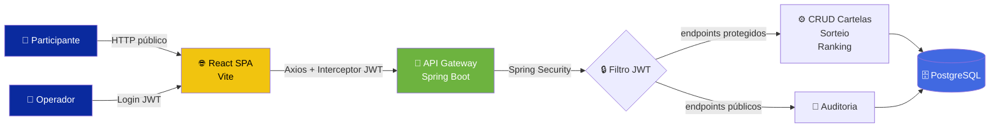
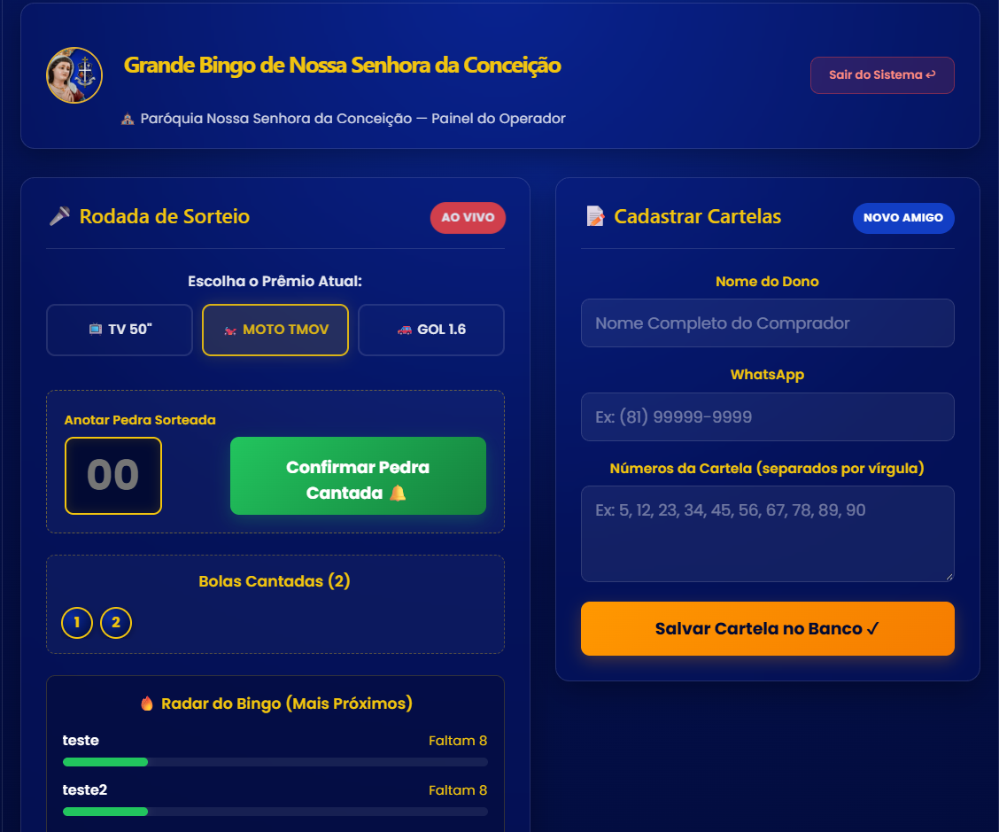
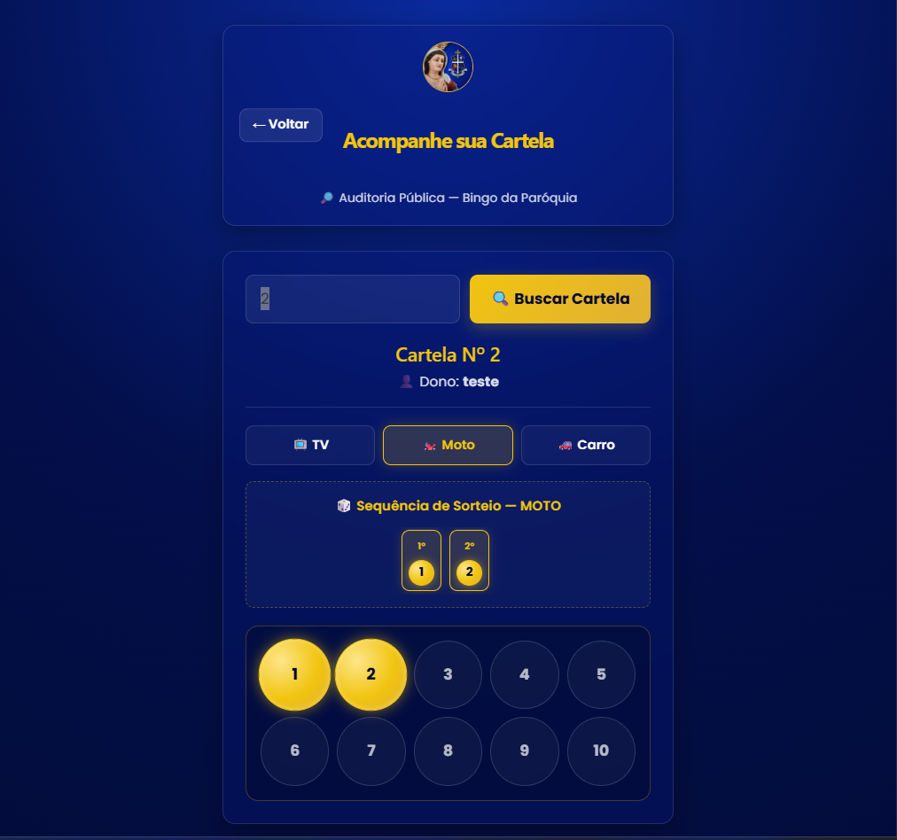

<div align="center">


# ⛪ Bingo da Paróquia — Sistema Full-Stack de Sorteio Ao Vivo

**Gerenciamento de bingo comunitário com radar em tempo real, autenticação JWT e auditoria pública de cartelas.**

[](https://react.dev/)
[](https://vitejs.dev/)
[](https://spring.io/projects/spring-boot)
[](https://openjdk.org/)
[](https://jwt.io/)
[](https://www.postgresql.org/)

[](#)
[](#-licença)
[](#-contribuindo)

**[🚀 Demo ao Vivo](#-demonstração)** · **[📺 Vídeo Completo](#-vídeo-de-demonstração)** · **[🐛 Reportar Bug](../../issues)** · **[💡 Sugerir Feature](../../issues)**

</div>

---

## 📋 Índice

- [Sobre o Projeto](#-sobre-o-projeto)
- [Vídeo de Demonstração](#-vídeo-de-demonstração)
- [Principais Funcionalidades](#-principais-funcionalidades)
- [Stack Tecnológica](#️-stack-tecnológica)
- [Arquitetura](#️-arquitetura)
- [Estrutura do Repositório](#-estrutura-do-repositório)
- [Como Executar Localmente](#️-como-executar-localmente)
- [Endpoints da API](#-endpoints-da-api)
- [Screenshots](#-screenshots)
- [Segurança](#️-segurança)
- [Roadmap](#-roadmap)
- [Contribuindo](#-contribuindo)
- [Licença](#-licença)
- [Autor](#-autor)

---

## 📌 Sobre o Projeto

O **Bingo da Paróquia** nasceu da necessidade real de modernizar os tradicionais sorteios comunitários: elimina conferência manual, garante transparência e traz uma experiência digital premium para operadores e participantes.

O grande diferencial é o **Radar de Aproximação**: um algoritmo que calcula em tempo real quais cartelas estão mais próximas de bater, exibindo tudo em barras de progresso visuais. Isso permite que o operador saiba *na hora* quem está "quente" — e os participantes podem conferir a própria cartela pela tela pública, sem precisar esperar o locutor.

A interface usa **Glassmorphism** com paleta azul royal (`#051877`) e acento dourado (`#f1c40f`), remetendo à tradição litúrgica mas com polimento moderno.

> 🎯 **Objetivo**: substituir o "bingo de papel" por uma experiência digital confiável, bonita e 100% responsiva.

---

## 📺 Vídeo de Demonstração

<div align="center">

### 🔥 Teaser rápido (GIF)


*— Cadastro → Sorteio ao vivo → Radar atualizando —*

### 🎥 Vídeo completo (3 min)

[](https://www.youtube.com/watch?v=SEU_VIDEO_ID_AQUI)

*Clique na imagem para assistir no YouTube*

</div>

> 💡 **Como criar o GIF**: use [LICEcap](https://www.cockos.com/licecap/) ou [Peek](https://github.com/phw/peek), grave 10–15s mostrando `Login → 3 pedras sorteadas → radar subindo → auditoria`, mantenha abaixo de **8MB** e otimize no [ezgif.com](https://ezgif.com/optimize) se necessário.

---

## 🚀 Principais Funcionalidades

### 🔐 Painel do Operador (Admin)

- **Autenticação JWT** com Spring Security stateless
- **CRUD de cartelas** — Nome, WhatsApp e as 10 dezenas associadas
- **Sorteio multi-prêmio** — TV, Moto e Carro em rodadas independentes
- **Radar de Aproximação** — as 3 cartelas mais próximas em barras animadas
- **Bloqueio automático** do sorteio quando há vencedor
- **Banner de vitória** com destaque visual dourado
- **Histórico de pedras cantadas** por prêmio

### 🔎 Área Pública (Participantes)

- **Auditoria sem login** — busca por ID da cartela
- **Visualização ao vivo** dos acertos por prêmio
- **Sequência pública de sorteio** com ordem das pedras
- **Destaque dourado** nas pedras cantadas que estão na sua cartela
- **Card de vitória** quando a cartela bate

---

## 🛠️ Stack Tecnológica

### Frontend


- **React 19** com Hooks + máquina de estados de tela (`login` / `admin` / `auditoria`)
- **Axios** com interceptors para injetar JWT e tratar 401
- **CSS puro** com variáveis, `backdrop-filter` e grid responsivo
- **Poppins** (Google Fonts) + design system dourado/azul

### Backend


- **Spring Boot 3** + **Spring Security** (stateless, JWT)
- **Spring Data JPA** (Hibernate) com `@ElementCollection` para as dezenas
- **JWT** com expiração configurável
- **CORS** configurado por `CorsConfigurationSource`
- **DTOs** (`AuditoriaDTO`, `RankingDTO`) para desacoplamento

---

## 🏗️ Arquitetura



**Fluxo resumido:**

1. Participante abre o SPA (público) e consulta sua cartela por ID
2. Operador faz login → recebe JWT → guarda em `localStorage`
3. Toda requisição autenticada passa pelo `JwtAuthenticationFilter`
4. Endpoints `/api/bingo/**` exigem token; `/public/**` são abertos
5. Ranking e vencedores são recalculados a cada pedra cantada

---

## 📁 Estrutura do Repositório

```bash
bingo-paroquia/
├── backend/                    # 🍃 API Spring Boot
│   ├── src/main/java/...
│   │   ├── controller/         # Endpoints REST
│   │   ├── service/            # Regras de negócio
│   │   ├── repository/         # Spring Data JPA
│   │   ├── model/              # Entidades (Cartela, Sorteio)
│   │   ├── dto/                # AuditoriaDTO, RankingDTO
│   │   └── security/           # JWT filter, CORS, UserDetails
│   ├── src/main/resources/
│   │   └── application.properties
│   └── pom.xml
│
├── frontend/                   # ⚛️ React + Vite
│   ├── src/
│   │   ├── assets/             # Logo da padroeira
│   │   ├── services/api.js     # Axios + interceptor
│   │   ├── App.jsx             # SPA (login + admin + auditoria)
│   │   └── App.css             # Glassmorphism
│   ├── package.json
│   └── vite.config.js
│
├── docs/                       # 📸 Screenshots e vídeos
│   ├── banner.png
│   ├── demo.gif
│   ├── login.png
│   ├── painel-admin.png
│   └── auditoria.png
│
├── .gitignore
├── LICENSE
└── README.md
```

---

## ⚙️ Como Executar Localmente

### Pré-requisitos

| Ferramenta | Versão |
|---|---|
| ☕ Java | 21+ |
| 📦 Maven | 3.9+ (ou use `./mvnw`) |
| 🟢 Node.js | 20+ |
| 📦 npm / pnpm | 10+ |
| 🗄️ PostgreSQL | 15+ |

### 1️⃣ Backend (Spring Boot)

```bash
cd backend

# Crie o banco
psql -U postgres -c "CREATE DATABASE bingo_db;"

# Configure as credenciais em src/main/resources/application.properties
# OU use variáveis de ambiente:
export DB_URL=jdbc:postgresql://localhost:5432/bingo_db
export DB_USER=postgres
export DB_PASS=sua_senha
export JWT_SECRET=chave-super-secreta-min-256-bits

# Rode
./mvnw spring-boot:run
```

✅ API em **http://localhost:8080**

### 2️⃣ Frontend (React + Vite)

```bash
cd frontend

npm install

# Ajuste a URL da API em src/services/api.js se necessário
# (padrão: http://localhost:8080)

npm run dev
```

✅ Painel em **http://localhost:5173**

### 🔑 Credenciais padrão (dev)

> Crie um usuário operador no banco ou use o `data.sql` com:
>
> - Usuário: `admin@paroquia.com`
> - Senha: `admin123`

---

## 🔌 Endpoints da API

### 🌐 Públicos

| Método | Rota | Descrição |
|---|---|---|
| `POST` | `/public/login` | Autenticar e receber JWT |
| `GET` | `/public/cartela/{id}` | Dados completos da cartela + histórico (AuditoriaDTO) |

### 🔒 Protegidos (requer `Authorization: Bearer <token>`)

| Método | Rota | Descrição |
|---|---|---|
| `POST` | `/api/bingo/cartelas` | Cadastrar cartela |
| `POST` | `/api/bingo/sortear/{premio}/{numero}` | Registrar pedra cantada |
| `GET` | `/api/bingo/ranking/{premio}` | Radar de aproximação |
| `GET` | `/api/bingo/sorteados/{premio}` | Lista de pedras já cantadas |
| `GET` | `/api/bingo/vencedores/{premio}` | Ganhadores do prêmio |

> `{premio}` aceita: `TV` · `MOTO` · `CARRO`

### Exemplo — Auditoria pública

```json
GET /public/cartela/42

{
  "cartela": {
    "id": 42,
    "nomeDono": "Maria Silva",
    "numeros": [5, 12, 23, 34, 45, 56, 67, 78, 89, 90],
    "bateuTv": false,
    "bateuMoto": false,
    "bateuCarro": false
  },
  "sequenciaSorteioTv": [5, 12, 23, 45, 67],
  "acertosTv": [5, 12, 23, 45, 67],
  "sequenciaSorteioMoto": [],
  "acertosMoto": [],
  "sequenciaSorteioCarro": [],
  "acertosCarro": []
}
```

---

## 📸 Screenshots

<div align="center">

### 🔐 Tela de Login


### 🎤 Painel do Operador — Sorteio + Radar


### 🔎 Auditoria Pública — Cartela do participante


</div>

> 💡 Para adicionar prints reais: tire screenshot, salve em `docs/`, e substitua os caminhos acima.

---

## 🛡️ Segurança

| Camada | Implementação |
|---|---|
| **Senhas** | BCrypt via `PasswordEncoder` |
| **Autenticação** | JWT stateless (sem sessão) |
| **Autorização** | `SecurityFilterChain` com matchers por rota |
| **CORS** | `CorsConfigurationSource` explícito por origem |
| **Tratamento 401** | Interceptor Axios faz logout automático |
| **Secrets** | Nunca comitadas — use variáveis de ambiente |
| **SQL Injection** | Protegido pelo JPA/Hibernate |

**⚠️ Antes de deploy em produção:**

- [ ] Rotacione o `JWT_SECRET`
- [ ] Configure HTTPS
- [ ] Restrinja origens no CORS
- [ ] Ative rate limiting no login

---

## 🗺️ Roadmap

- [x] Autenticação JWT
- [x] Radar em tempo real
- [x] Área pública de auditoria
- [x] Sequência pública de sorteio
- [ ] **WebSocket** para atualização sem *polling*
- [ ] **Painel de múltiplas rodadas** simultâneas
- [ ] **QR Code** por cartela para acesso rápido
- [ ] **Exportação** de relatório em PDF
- [ ] **PWA** com modo offline
- [ ] **Testes E2E** com Playwright

---

## 🤝 Contribuindo

Contribuições são muito bem-vindas! 🎉

```bash
# 1. Faça fork
# 2. Crie sua branch
git checkout -b feature/minha-feature

# 3. Commit seguindo Conventional Commits
git commit -m "feat: adiciona exportação PDF"

# 4. Push
git push origin feature/minha-feature

# 5. Abra um Pull Request
```

**Padrões:**

- Commits: [Conventional Commits](https://www.conventionalcommits.org/pt-br/)
- Estilo: ESLint + Prettier (frontend) · Checkstyle (backend)
- Cobertura mínima de testes: 70%

---

## 📄 Licença

Distribuído sob a **Licença MIT**. Veja [`LICENSE`](./LICENSE) para mais detalhes.

---

## 👨‍💻 Autor

<div align="center">

**Otaviano Cruz**

*Desenvolvedor Full-Stack · Entusiasta de boas UX e código limpo*

[](https://www.linkedin.com/in/SEU_USUARIO/)
[](https://github.com/SEU_USUARIO/)
[](mailto:seu@email.com)

</div>

<div align="center">

**⭐ Se este projeto te ajudou, deixe uma estrela!**

Feito com 💙 e ☕ para a Paróquia Nossa Senhora da Conceição

</div>